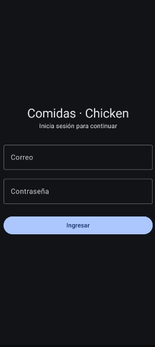
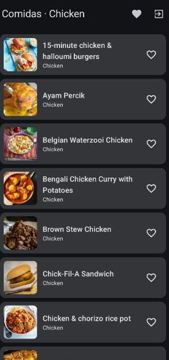
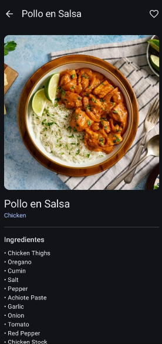
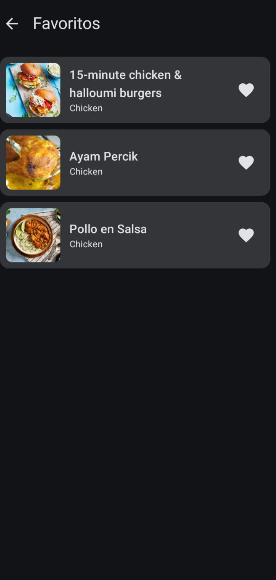
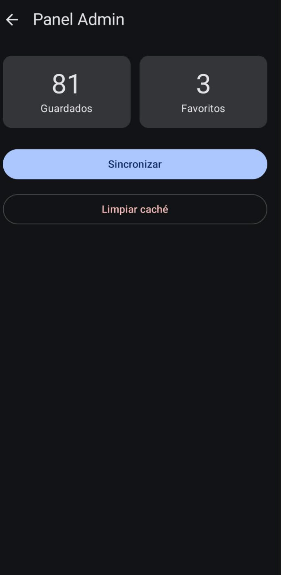
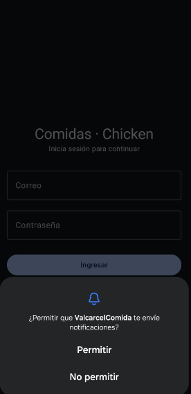
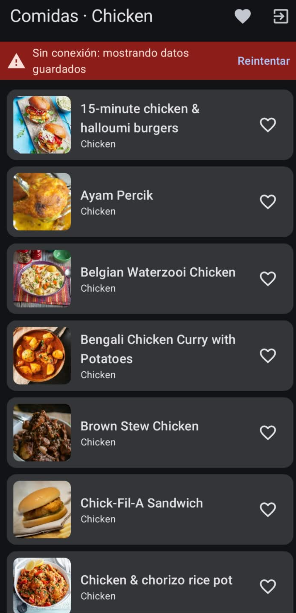
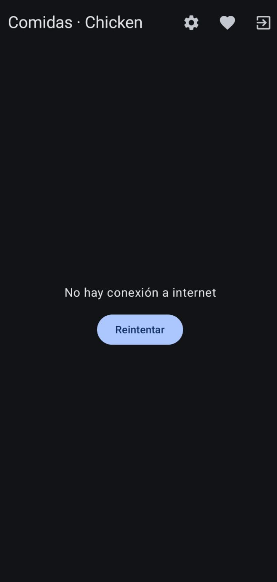

# Comidas · Chicken

Laboratorio 11-12 · Programación en Móviles · Tecsup  
App Android en Kotlin con **Jetpack Compose + MVVM + Retrofit + Room + Firebase Auth/Firestore** y notificaciones locales.

| |                                |
|---|--------------------------------|
| **Integrante** | David.V.L - trabajo individual |
| **Tema** | Comidas (TheMealDB)            |
| **Variante** | Categoría **Chicken**          |
| **Paquete** | `com.tuapp.valcarcelcomida`    |

---

## Qué hace la app

- **Login** con correo y contraseña (Firebase Authentication). Valida campos vacíos y muestra el error si las credenciales fallan.
- **Dos roles** (`admin` y `usuario`) leídos de Firestore en `usuarios/{uid}`. El rol decide si se ve el Panel Admin.
- **Lista** de comidas de pollo desde la API, con estados Cargando, Error (con Reintentar) y Vacío.
- **Detalle** de cada comida con el segundo endpoint: categoría, país, ingredientes y preparación.
- **Favoritos** que se marcan y desmarcan, con su propia pantalla. Se conservan al cerrar la app y al sincronizar.
- **Modo sin conexión**: sin internet se muestra lo guardado en Room con un aviso. Si no hay nada guardado, aparece el error con Reintentar.
- **Notificación local** «Se guardaron N elementos» al terminar de sincronizar. Al tocarla se abre la app.
- **Panel Admin** (solo admin): total guardado, total de favoritos, botón Sincronizar y botón Limpiar caché.
- **Sesión** que se mantiene al reabrir la app y botón Cerrar sesión.

## API utilizada

Base: `https://www.themealdb.com/api/json/v1/1/`

| Uso | Endpoint |
|---|---|
| Lista | `filter.php?c=Chicken` |
| Detalle | `lookup.php?i={id}` |

La lista solo trae `idMeal`, `strMeal` y `strMealThumb`. El detalle trae los demás campos, entre ellos `strIngredient1` a `strIngredient20`. Cuando no hay resultados, la API devuelve `"meals": null`.

---

## Cómo compilar

1. Clonar el repositorio y abrirlo en Android Studio.
2. Colocar el archivo **`google-services.json`** dentro de la carpeta `app/` (ver la sección de Firebase). Este archivo **no está en el repositorio** porque contiene la clave de API.
3. **Sync Project with Gradle Files**.
4. **Build → Clean Project** y luego **Build → Rebuild Project**.
5. Ejecutar en un emulador **con Google Play** y Android 13 o superior (para probar el permiso de notificaciones).

### Versiones relevantes

El proyecto usa **AGP 9 con Kotlin integrado**, por eso algunas versiones son más nuevas que las de la guía:

| Librería / plugin | Versión |
|---|---|
| KSP | 2.3.6 (las versiones con formato `<kotlin>-<ksp>` no son compatibles con Kotlin integrado) |
| Google Services plugin | 4.4.4 |
| Room | 2.8.5 |
| Retrofit | 2.11.0 + converter kotlinx-serialization |
| OkHttp | 4.12.0 |
| Navigation Compose | 2.8.4 |
| Firebase BoM | 33.5.1 |
| Coil (imágenes) | 2.7.0 |

---

## Configuración de Firebase y usuarios de prueba

1. En [console.firebase.google.com](https://console.firebase.google.com/) crear un proyecto.
2. Registrar una app Android con el paquete exacto **`com.tuapp.valcarcelcomida`**.
3. Descargar `google-services.json` y colocarlo en `app/`.
4. **Authentication → Método de acceso**: habilitar **Correo electrónico/contraseña**.
5. **Authentication → Usuarios**: crear dos usuarios y copiar sus **UID**.
    - `admin@valcarcel.com`
    - `usuario@valcarcel.com`
6. **Firestore Database**: crear la base de datos y la colección **`usuarios`**, con un documento por usuario. **El ID del documento es el UID** del usuario.

   | ID del documento | `rol` (string) | `nombre` (string) |
      |---|---|---|
   | UID del admin | `admin` | Administrador |
   | UID del usuario | `usuario` | Usuario de prueba |

7. **Firestore → Reglas**: publicar estas reglas.

```
rules_version = '2';
service cloud.firestore {
  match /databases/{database}/documents {
    match /usuarios/{uid} {
      allow read: if request.auth != null && request.auth.uid == uid;
      allow write: if false;
    }
  }
}
```

> El rol en la app solo decide qué se muestra. Lo que protege los datos son las reglas de Firestore: cada usuario solo puede leer su propio documento y nadie puede escribir desde la app.

Las contraseñas de los usuarios de prueba se entregan al docente por el aula virtual, no se publican en el repositorio.

---

## Arquitectura

MVVM con el repositorio como interface y **Room como fuente única de verdad**: la lista que ve el usuario sale siempre de Room y Retrofit solo la actualiza.

```
UI (Compose)  --eventos-->  ViewModel  -->  Repository (interface)  -->  Retrofit (API)
     ^                          |                    |                -->  Room (local)
     +-------- estado ----------+                    |                -->  Firebase (Auth + Firestore)
                                |
                                +--avisa-->  Notificador (interface)
```

- Las pantallas solo observan el estado con `collectAsStateWithLifecycle()` y llaman funciones del ViewModel. Ningún composable usa Retrofit, Room ni Firebase.
- Los ViewModel no reciben `Context`. La notificación se pide mediante la interface `Notificador`.
- Los ViewModel dependen de las interfaces `ItemRepository` y `AuthRepository`, nunca de las clases concretas.
- Tres modelos distintos: `ItemDto` (API), `ItemEntity` (Room) e `Item` (UI), convertidos en `Mappers.kt`.
- Cada ViewModel expone un `StateFlow<UiState<T>>` (Cargando, Exito, Error) que solo él modifica.
- Los ViewModel se crean con un `ViewModelProvider.Factory` que recibe el `AppContainer`.
- Al sincronizar, el repositorio lee los ids favoritos **antes** de guardar y los vuelve a aplicar, para que el `@Upsert` no los borre.

### Estructura de carpetas

```
app/src/main/java/com/tuapp/valcarcelcomida/
├── MainActivity.kt
├── AppContainer.kt
├── data/
│   ├── remote/      ApiService.kt · RetrofitClient.kt · dto/ItemDto.kt
│   ├── local/       ItemEntity.kt · ItemDao.kt · AppDatabase.kt
│   ├── auth/        AuthRepository.kt · FirebaseAuthRepository.kt
│   ├── repository/  ItemRepository.kt · ItemRepositoryImpl.kt
│   └── mapper/      Mappers.kt
├── domain/model/    Item.kt · Sesion.kt
├── notification/    Notificador.kt · NotificadorAndroid.kt
└── ui/
    ├── navigation/  AppNav.kt
    ├── UiState.kt
    ├── login/       LoginScreen.kt · LoginViewModel.kt
    ├── lista/       ListaScreen.kt · ListaViewModel.kt
    ├── detalle/     DetalleScreen.kt · DetalleViewModel.kt
    ├── favoritos/   FavoritosScreen.kt · FavoritosViewModel.kt
    ├── admin/       AdminScreen.kt · AdminViewModel.kt
    ├── components/  Cargando.kt · ErrorView.kt
    └── theme/
```

---

## Capturas

| Login | Lista | Detalle |
|---|---|---|
|  |  |  |

| Favoritos | Panel Admin | Notificación |
|---|---|---|
|  |  |  |

| Sin conexión | Error sin datos |
|---|---|
|  |  |

---

## Pruebas de aceptación

| Cód. | Caso | Resultado |
|---|---|---------|
| PA-01 | Ingresar con el usuario `usuario` | ✅       |
| PA-02 | Ingresar con el usuario `admin` | ✅       |
| PA-03 | Contraseña incorrecta | ✅       |
| PA-04 | Correo o clave vacíos | ✅      |
| PA-05 | Primera apertura con internet | ✅      |
| PA-06 | Tocar un elemento | ✅       |
| PA-07 | Marcar un favorito y cerrar la app | ✅       |
| PA-08 | Modo avión con datos guardados | ✅       |
| PA-09 | Modo avión sin datos | ✅       |
| PA-10 | Sincronizar después de marcar un favorito | ✅       |
| PA-11 | Admin pulsa Limpiar caché | ✅       |
| PA-12 | Cerrar sesión y reabrir la app | ✅       |
| PA-13 | Girar la pantalla | ✅       |
| PA-14 | Negar el permiso de notificaciones | ✅       |

---

## Reparto de tareas

Trabajo realizado **de forma individual**: todos los hitos (H1 a H16), los commits y la Fase 2 fueron hecho por David.V.L

| Hito | Commit |
|---|---|
| H1 | `chore: crear proyecto base con Compose` |
| H2 | `chore: crear estructura MVVM y contratos` |
| H3 | `feat: agregar componentes Cargando y ErrorView` |
| H4 | `feat: lista con datos de prueba` |
| H5 | `feat: ApiService y RetrofitClient` |
| H6 | `feat: la lista consume la API` |
| H7 | `feat: pantalla de detalle` |
| H8 | `feat: base de datos Room` |
| H9 | `refactor: Room como fuente de verdad` |
| H10 | `feat: favoritos` |
| H11 | `feat: modo sin conexion` |
| H12 | `chore: configurar Firebase` |
| H13 | `feat: login con Firebase Auth` |
| H14 | `feat: roles y panel Admin` |
| H15 | `feat: notificacion local` |
| H16 | `docs: README` |

## Fase 2 (con IA)

Las mejoras hechas con ayuda de IA están en la rama **`mejora-ia12`**, documentadas en [`PROMPTS.md`](PROMPTS.md), con su Pull Request hacia `main`.