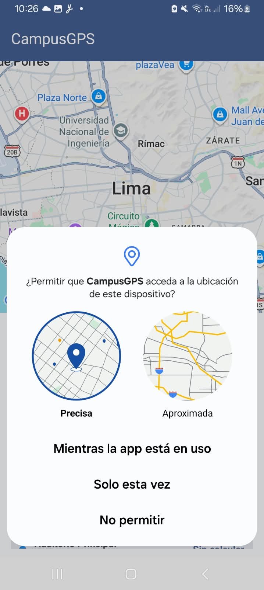
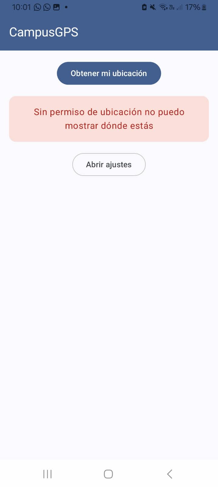
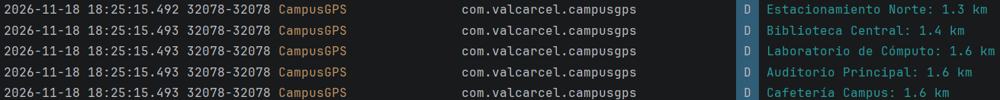
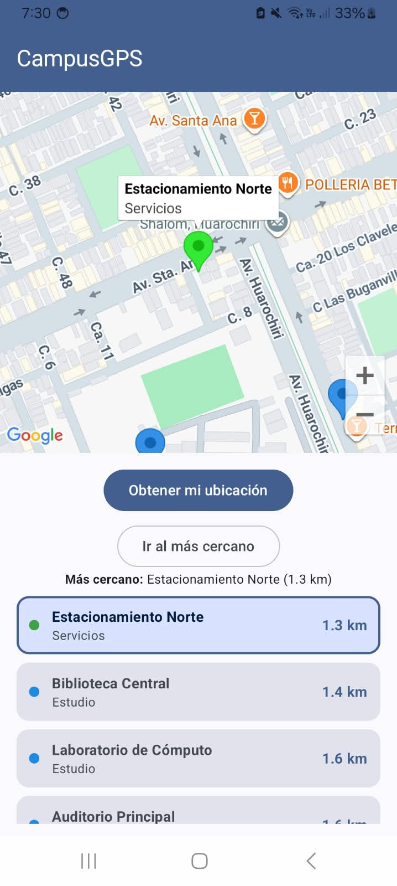
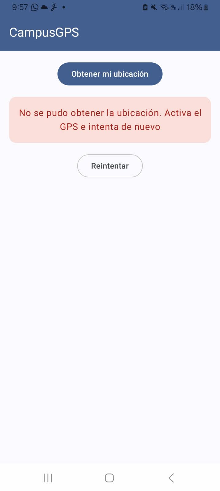

# CampusGPS

App Android que obtiene la ubicación del celular, la muestra en un mapa y te dice qué lugar del campus tienes más cerca. Muestra cinco puntos ficticios (biblioteca, cafetería, laboratorio, auditorio y estacionamiento) con su distancia, ordenados del más cercano al más lejano.

Laboratorio de la semana 13

## Tecnologías

- Kotlin + Jetpack Compose + Material 3 (sin XML)
- Google Play Services Location (`FusedLocationProviderClient`)
- Maps Compose (Google Maps SDK for Android)
- Patrón MVVM + Repository (interfaces)

## Configuración

La clave de Google Maps no está en el repositorio. Para compilar el proyecto:

1. Crea una clave en Google Cloud con **Maps SDK for Android** habilitado y restríngela al paquete `com.valcarcel.campusgps` y a tu huella SHA-1 (`./gradlew signingReport`).
2. Agrega esta línea a `local.properties` (este archivo está en `.gitignore`):

```properties
MAPS_API_KEY=tu_clave
```

3. Sincroniza Gradle y ejecuta la app.

## Estructura de paquetes

```
com.valcarcel.campusgps/
├── MainActivity.kt
├── model/
│   └── Modelos.kt                    Posicion, Lugar, LugarConDistancia, UbicacionUi, TipoError
├── data/
│   ├── UbicacionRepository.kt        interface + UbicacionNoDisponibleException
│   ├── UbicacionRepositoryGoogle.kt  implementación con Fused Location
│   ├── LugaresRepository.kt          interface
│   └── LugaresRepositoryLocal.kt     los 5 lugares
├── util/
│   ├── Distancia.kt                  distanciaMetros()
│   └── Formato.kt                    formatearDistancia()
├── viewmodel/
│   ├── MapaViewModel.kt
│   └── CampusViewModelFactory.kt
└── ui/
    ├── PantallaMapa.kt
    ├── MapaUbicacion.kt
    ├── ListaLugares.kt
    ├── MensajeError.kt
    └── theme/
```

## Arquitectura MVVM + Repository

```
View (PantallaMapa, MapaUbicacion, ListaLugares, MensajeError)
   | evento: pulsar el botón o una tarjeta     ^ collectAsState()
   v                                           |
ViewModel (MapaViewModel) ---- StateFlow ------>
   | llama solo a las interfaces
   v
UbicacionRepository ---> UbicacionRepositoryGoogle (FusedLocationProviderClient)
LugaresRepository   ---> LugaresRepositoryLocal (los 5 lugares fijos)

util/ (distanciaMetros, formatearDistancia): funciones puras, sin estado
```

| Capa | Conoce a | No hace |
|---|---|---|
| View (`ui/`) | Solo a su ViewModel | No usa Repository ni `FusedLocationProviderClient`, ni calcula distancias |
| ViewModel | Solo a las interfaces de Repository | No conoce Composables ni recibe un `Context` |
| Repository | Google Play Services (en la implementación) | No expone clases de UI |
| `util/` | Nada | No guarda estado |

## Datos de los lugares

Los 5 lugares son ficticios (sección 5 del laboratorio). Para probar la app en un celular físico dentro del campus, se trasladaron alrededor del patio central de Tecsup (-12.0441, -76.9529), manteniendo la misma separación entre ellos que en el enunciado.

| Id | Nombre | Categoría | Latitud | Longitud |
|---|---|---|---|---|
| 1 | Biblioteca Central | Estudio | -12.0437 | -76.9536 |
| 2 | Cafetería Campus | Comida | -12.0447 | -76.9521 |
| 3 | Laboratorio de Cómputo | Estudio | -12.0432 | -76.9516 |
| 4 | Auditorio Principal | Eventos | -12.0457 | -76.9541 |
| 5 | Estacionamiento Norte | Servicios | -12.0417 | -76.9531 |

Las pruebas se hicieron en un celular físico.

## Capturas

### Paso 2 · Pedir el permiso

| Cuadro de permiso | Permiso denegado                              |
|---|-----------------------------------------------|
|  |  |

### Pasos 3 y 4 · Mapa y marcadores

| Mapa con mi ubicación | Marcadores de los lugares |
|---|---|
|  |  |

### Paso 5 · Distancias calculadas (Logcat)



### Pasos 6 y 7 · Lista, selección y lugar más cercano

| Lista ordenada y selección | Lugar más cercano |
|--|---|
| |  |

### Paso 8 · Estados de error

| Permiso denegado (Abrir ajustes) | GPS apagado (Reintentar) |
|---|---|---|
|  |  |

## Pruebas de aceptación

| Prueba | Resultado esperado | OK  |
|---|---|-----|
| Abrir la app por primera vez y pulsar el botón | Aparece el cuadro de permiso | [✅] |
| Aceptar el permiso | Se ven latitud, longitud y el marcador Estás aquí | [✅] |
| Negar el permiso | Mensaje de error con Abrir ajustes, la app no se cierra | [✅] |
| Ubicación en el punto base | Los 5 marcadores aparecen cerca de tu posición | [✅] |
| Tocar un marcador | Se ve el nombre y la categoría del lugar | [✅] |
| Lista de lugares | Ordenada de menor a mayor distancia, con m o km | [✅] |
| Tocar una tarjeta de la lista | La cámara viaja a ese lugar y la tarjeta queda resaltada | [✅] |
| Ir al más cercano | La cámara va al lugar verde; el botón está deshabilitado antes de buscar | [✅] |
| Cambiar la ubicación y buscar otra vez | Las distancias, el orden y el lugar verde se actualizan | [✅] |
| Ubicación apagada | Mensaje de GPS con Reintentar | [✅] |
| Rotar la pantalla | No se pierden la ubicación ni la lista | [✅] |
| Revisar el repositorio | La clave no aparece y `local.properties` no está subido | [✅] |

## Para pensar

**1. ¿Por qué `FusedLocationProviderClient` está dentro del Repository y no en el ViewModel?**

el ViewModel solo conoce interfaces. Para no depender de Google ni de un Context, y la fuente de ubicación se puede cambiar o simular en pruebas sin tocar el ViewModel.

**2. ¿Qué diferencia hay entre el permiso de ubicación y la clave de API de Maps? ¿Qué pasa si falta cada uno?**

El permiso lo da el usuario y sirve para leer su ubicación; sin él, la app muestra el error con Abrir ajustes. La clave identifica a tu app ante Google Maps.

**3. ¿Por qué la clave va en `local.properties` y no en el código? ¿Qué harías si se subiera a GitHub por error?**

está en .gitignore, así que la clave no se sube a GitHub, y llega al Manifest con manifestPlaceholders. Si se subiera se tendria que  borrar el Google Cloud con esa clave y crear una nueva.

**4. ¿Dónde calculas la distancia y por qué no en el Composable?**

Se calcula en el ViewModel (actualizarDistancias) con util/distanciaMetros. Si se calculara en el Composable se repetiría en cada recomposición, se rompería el MVVM.

**5. ¿Qué pasa con tu app si el usuario niega el permiso dos veces? ¿Cómo lo manejas?**

La aplicacion ya no vuelve a mostrar el cuadro. La app lo maneja con el mensaje y el botón Abrir ajustes, que lleva a la pantalla de permisos de la app.