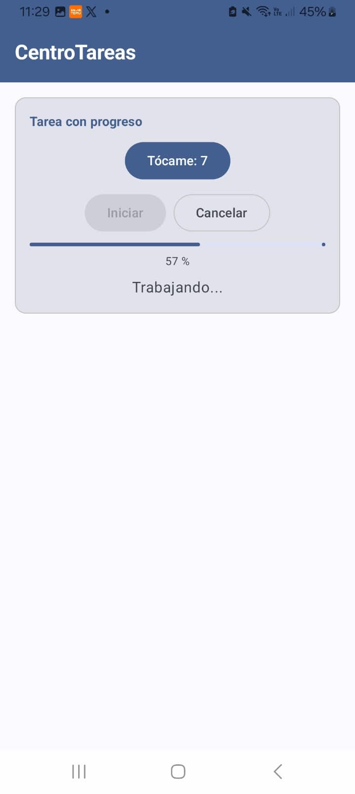
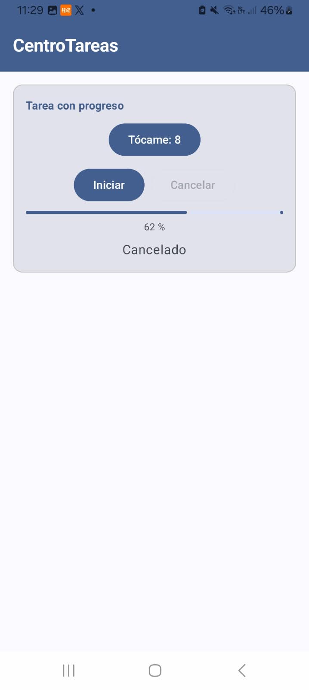
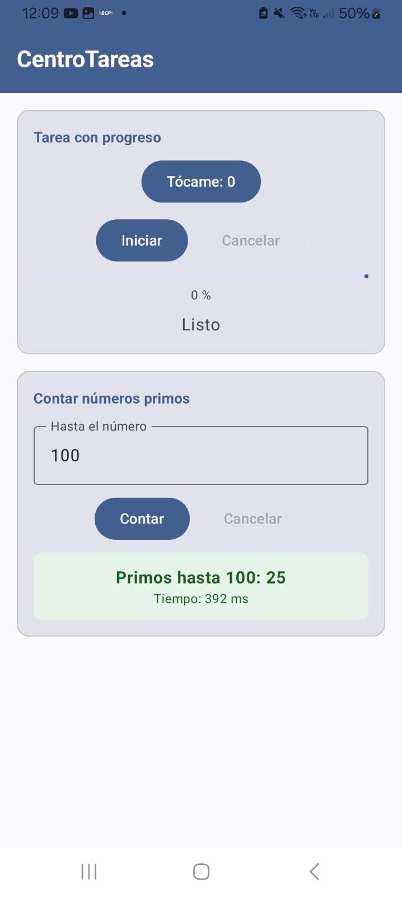
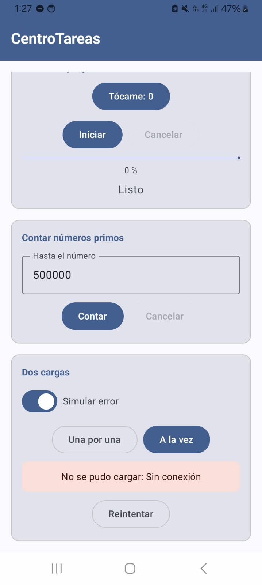
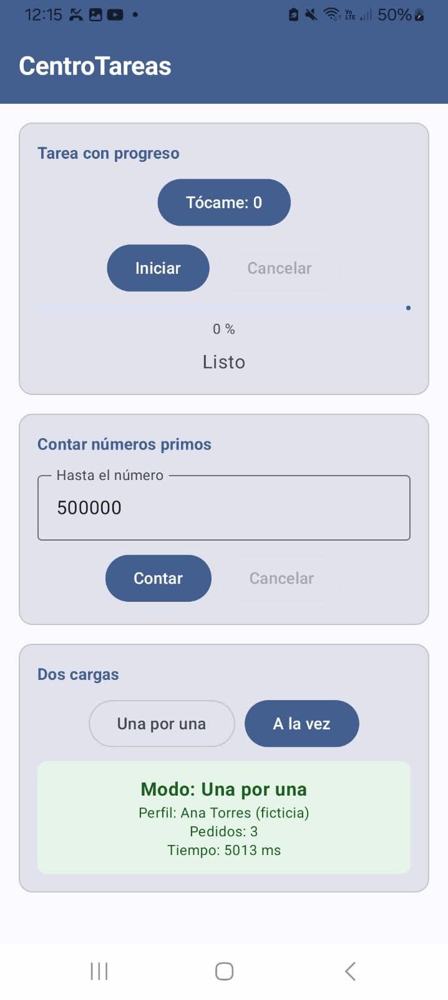
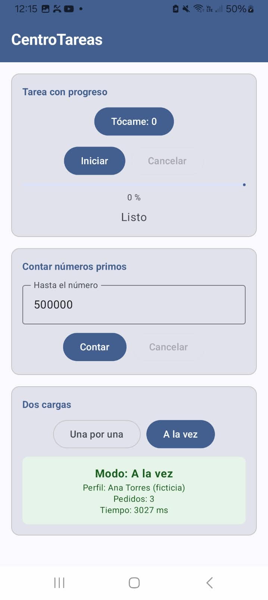
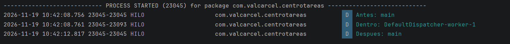

# CentroTareas

App Android hecha con Kotlin, Jetpack Compose y Material 3 que ejecuta tres
tareas que tardan sin congelar la pantalla:

- una **tarea con progreso** que se puede cancelar,
- un **cálculo pesado** (contar números primos hasta N) que también se puede cancelar,
- **dos cargas de datos simuladas** (perfil y pedidos), una por una o a la vez,
  con manejo de errores y reintento.

Todo el trabajo largo se hace en segundo plano con corrutinas y el resultado
vuelve al hilo principal. Todos los datos son ficticios.

**Tecnología:** Kotlin, Jetpack Compose, Material 3, corrutinas, ViewModel y StateFlow.
**Patrón:** MVVM + Repository (interface).

## Estructura de paquetes

```
com.valcarcel.centrotareas/
├── MainActivity.kt
├── model/
│   └── Estados.kt                   PrimosUi, CargaUi
├── data/
│   ├── TareasRepository.kt          interface
│   └── TareasRepositoryLocal.kt     cargas simuladas y contarPrimos
├── viewmodel/
│   ├── TareasViewModel.kt           tarea larga, primos y cargas
│   └── TareasViewModelFactory.kt
└── ui/
    ├── PantallaTareas.kt            las tres tarjetas
    └── theme/
```

## Arquitectura MVVM + Repository

```
 View (PantallaTareas)
    | eventos: botones              ^ collectAsState()
    v                               |
 ViewModel (TareasViewModel) --- StateFlow --->
    | viewModelScope.launch { ... }
    v
 TareasRepository (interface) ---> TareasRepositoryLocal
                                    (cargas simuladas y contar primos)
```

| Capa | Responsabilidad |
|---|---|
| View (`ui/`) | Muestra el estado y avisa los eventos. No lanza corrutinas ni usa `Thread` |
| ViewModel | Lanza las corrutinas con `viewModelScope` y expone el estado con `StateFlow`. Solo conoce la interface del Repository |
| Repository | Hace el trabajo: cargas simuladas con `delay` y conteo de primos en `Dispatchers.Default`. No conoce nada de la UI |

## Observación del Paso 1

**Qué pasa con la pantalla:** al pulsar "Tarea larga (MAL)" la app deja de
responder durante unos 4 segundos. Si toco "Tócame" en ese tiempo, el contador
no sube y los botones no reaccionan. Cuando terminan los 4 segundos, la
pantalla vuelve a responder y el mensaje cambia a "Terminó".

Los toques hechos durante el congelamiento no se pierden: quedan en la cola de
eventos del hilo principal y se procesan todos juntos cuando termina
`Thread.sleep`, por eso el contador salta de golpe al número de veces que
presioné. Después, los toques se registran normalmente y el mensaje se queda
en "Terminó" hasta que vuelvo a lanzar la tarea.

**Por qué no se ve "Trabajando...":** `tareaLargaMala()` se ejecuta en el hilo
principal, que es el mismo hilo que dibuja la pantalla y atiende los toques.
El valor del mensaje sí cambia a "Trabajando...", pero `Thread.sleep(4000)`
bloquea ese hilo y Compose no puede redibujar. Cuando el hilo se libera, el
mensaje ya cambió a "Terminó", por eso solo se dibuja el valor final.

**Qué mostraría Android con 10 segundos:** al no responder a los toques
durante más de unos 5 segundos, Android mostraría el diálogo ANR
("La aplicación no responde"), con las opciones de cerrar la app o esperar.

## Capturas

| Tarea con progreso | Tarea cancelada |
|---|---|
|  |  |

| Contar primos | Error y Reintentar |
|---|---|
|  |  |

**Una por una contra a la vez:**

| Una por una (≈ 5000 ms) | A la vez (≈ 3000 ms) |
|---|---|
|  |  |

**Logcat con filtro HILO:**



## Pruebas de aceptación

| Prueba | Resultado esperado | OK |
|---|---|---|
| Tarea larga: tocar Tócame mientras trabaja | El contador sigue sumando | ☑ |
| Logcat con filtro HILO | `main` antes y después; `DefaultDispatcher-worker` dentro | ☑ |
| Iniciar la tarea con progreso | La barra avanza de 0 a 100 % en ≈ 4 s | ☑ |
| Cancelar a mitad | La barra se detiene, dice Cancelado y se puede iniciar otra vez | ☑ |
| Pulsar Iniciar dos veces seguidas | No se lanzan dos tareas (el botón está deshabilitado) | ☑ |
| Primos hasta 1000 | Resultado 168 | ☑ |
| Primos con N grande | La pantalla no se congela y Cancelar funciona | ☑ |
| Una por una | ≈ 5 s y resultado correcto | ☑ |
| A la vez | ≈ 3 s y resultado correcto | ☑ |
| Error simulado + Reintentar | Recuadro rojo; al desactivar el interruptor y reintentar, éxito | ☑ |
| Rotar la pantalla durante la tarea | La tarea continúa y el progreso no se reinicia | ☑ |
| Revisar el código | `git grep` no encuentra `GlobalScope`, `runBlocking` ni `Thread.sleep` | ☑ |

En mi emulador, contar primos hasta 500 000 tardó unos 1840 ms (resultado: 41 538).

## Para pensar

**1. ¿Por qué no se veía "Trabajando..." en el Paso 1?**
Porque `Thread.sleep(4000)` bloqueaba el hilo principal, que es el único que
dibuja la pantalla. El mensaje sí cambió a "Trabajando...", pero Compose no
tuvo oportunidad de redibujar hasta que el hilo se liberó, y para ese momento
el mensaje ya era "Terminó".

**2. ¿Qué diferencia hay entre `Thread.sleep` y `delay`?**
`Thread.sleep` bloquea el hilo completo: nadie más puede usarlo mientras
duerme. `delay` es una función `suspend` que suspende solo la corrutina y
libera el hilo para que haga otro trabajo; cuando pasa el tiempo, la corrutina
continúa. Además, `delay` revisa la cancelación, así que una corrutina
cancelada se detiene en el `delay`, mientras que `Thread.sleep` no se entera.

**3. ¿Por qué `Dispatchers.Default` para los primos y `Dispatchers.IO` para la red?**
Contar primos usa el procesador todo el tiempo (trabajo de CPU).
`Dispatchers.Default` tiene tantos hilos como núcleos tiene el procesador, que
es lo ideal para cálculos. La red y el disco pasan la mayor parte del tiempo
esperando una respuesta. `Dispatchers.IO` tiene muchos más hilos, para que
muchas esperas puedan ocurrir a la vez sin agotar los hilos de cálculo.

**4. ¿Qué pasaría con la corrutina si el usuario cierra la pantalla? ¿Qué papel cumple `viewModelScope`?**
`viewModelScope` está atado a la vida del ViewModel. Si el usuario cierra la
pantalla de forma definitiva, el ViewModel se destruye (`onCleared`) y
`viewModelScope` cancela automáticamente todas sus corrutinas, así no quedan
trabajos sueltos gastando recursos. Si solo rota la pantalla, el ViewModel
sobrevive y la corrutina sigue: por eso la barra no se reinicia al rotar.

**5. ¿Por qué `async` tarda 3 s y no 5 s? ¿Qué pasa si una de las dos cargas falla?**
Con `async` las dos cargas empiezan al mismo tiempo y se esperan juntas, así
que el tiempo total es el de la más lenta: máximo(2 s, 3 s) ≈ 3 s. Una por una
se suman: 2 s + 3 s ≈ 5 s. Si una falla dentro de `coroutineScope`, el scope
cancela automáticamente la otra carga y lanza la excepción. El `try/catch` del
ViewModel la captura y muestra el estado de error con el botón Reintentar.