# 🐾 HuellitasVet

App Android para la gestión de una veterinaria, desarrollada con **Kotlin + Jetpack Compose + Material 3**, **Room** y **DataStore**, siguiendo la arquitectura **MVVM + Repository**.

> Laboratorio 08 · MVVM + Room — Programación en Móviles

---

## 📱 Descripción

HuellitasVet tiene **dos perfiles en el mismo dispositivo** que comparten la misma base de datos Room:

- **Dueño:** registra a sus mascotas, pide citas eligiendo servicio, fecha y hora, cancela citas (hasta 2 horas antes) y consulta el historial clínico de cada mascota.
- **Veterinario:** ve el panel de la clínica con contadores y gráficos, confirma citas en la agenda, registra la atención (diagnóstico, tratamiento y peso), consulta a los pacientes y administra los servicios.

Cuando el veterinario registra una atención, el dueño la ve **al instante** en el historial de su mascota, porque todas las lecturas son `Flow` de Room.

### Usuarios de prueba (datos ficticios · Ley 29733)

| Perfil | Correo | Clave |
|---|---|---|
| Dueño | `ana@correo.test` | `1234` |
| Dueño | `luis@correo.test` | `1234` |
| Veterinario | `vet@huellitas.test` | `admin` |

---

## 🛠️ Tecnologías

| Tecnología | Uso |
|---|---|
| Kotlin + Jetpack Compose | Interfaz declarativa, sin XML |
| Material 3 | Tema por rol (esmeralda para el dueño, azul para el veterinario) y modo oscuro |
| Room 2.6.1 + KSP | Base de datos local con 4 tablas, relaciones anidadas y transacciones |
| DataStore Preferences | Perfil activo, modo oscuro, notificaciones y "Aceptar citas" |
| Navigation Compose | Un grafo con la navegación de cada perfil |
| Coroutines + Flow | `Flow` para lecturas reactivas y `suspend` para escrituras |
| java.time | Reglas con fechas y horas (minSdk 26) |
| Canvas | Avatar de las mascotas y gráficos de dona y barras |

---

## 🏗️ Arquitectura MVVM

```
┌──────────────────────────────────────────┐
│  VIEW (Composables)                      │
│  ui/dueno · ui/veterinario               │
└──────────────────────────────────────────┘
        │ eventos (clics)        ▲ collectAsState()
        ▼                        │
┌──────────────────────────────────────────┐
│  VIEWMODEL                               │      ┌──────────────────────┐
│  StateFlow + reglas de negocio           │ ◄─── │  DataStore           │
└──────────────────────────────────────────┘      │  (solo preferencias) │
        │ llama                  ▲ Flow /         └──────────────────────┘
        ▼                        │ resultados
┌──────────────────────────────────────────┐
│  VetRepository (interface)               │
└──────────────────────────────────────────┘
        │ la implementa
        ▼
┌──────────────────────────────────────────┐
│  VetRepositoryRoom ──► DAOs ──► SQLite   │
└──────────────────────────────────────────┘
```

| Capa | Conoce a | No debe conocer |
|---|---|---|
| View (`ui/`) | Solo a su ViewModel | DAO, Repository ni reglas de negocio |
| ViewModel (`viewmodel/`) | Solo la interface `VetRepository` (y `PreferenciasStore`) | Composables ni DAOs |
| Repository (`data/repository/`) | Los DAOs | Pantallas ni ViewModels |
| DAO / Room (`data/local/`) | SQL y entidades | ViewModels |

**Regla de oro:** lectura que debe actualizar la pantalla → `Flow` (sin `suspend`). Escritura o acción única → `suspend`.

`VetRepository` es una **interface**: en la Semana 9 se podrá conectar a un servicio web creando otra implementación, sin cambiar ViewModels ni pantallas.

---

## 📂 Estructura de paquetes

```
com.tecsup.huellitasvvet
├── MainActivity.kt
├── VetApp.kt                      crea la base y el repositorio; siembra los datos
│
├── data
│   ├── local
│   │   ├── entity
│   │   │   ├── Servicio.kt
│   │   │   ├── Usuario.kt
│   │   │   ├── Mascota.kt
│   │   │   └── Cita.kt
│   │   ├── dao
│   │   │   ├── ServicioDao.kt
│   │   │   ├── UsuarioDao.kt
│   │   │   ├── MascotaDao.kt
│   │   │   └── CitaDao.kt
│   │   ├── relation
│   │   │   ├── MascotaConDueno.kt
│   │   │   └── CitaConDetalle.kt     relación anidada: cita → mascota → dueño
│   │   ├── VetDatabase.kt            singleton
│   │   └── DatosIniciales.kt
│   ├── repository
│   │   ├── VetRepository.kt          interface (el contrato)
│   │   └── VetRepositoryRoom.kt      implementación con Room
│   └── prefs
│       └── PreferenciasStore.kt
│
├── model
│   ├── Rol.kt  EstadoCita.kt  Especie.kt  Sexo.kt
│   ├── ConteoServicio.kt
│   └── Horarios.kt                   18 horarios de 09:00 a 17:30
│
├── viewmodel
│   ├── VetViewModelFactory.kt
│   ├── SesionViewModel.kt
│   ├── InicioViewModel.kt
│   ├── MascotaViewModel.kt
│   ├── PedirCitaViewModel.kt
│   ├── MisCitasViewModel.kt
│   ├── PanelViewModel.kt
│   ├── AgendaViewModel.kt
│   ├── AtenderCitaViewModel.kt
│   ├── PacientesViewModel.kt
│   └── ServiciosViewModel.kt
│
└── ui
    ├── theme           Color.kt  Type.kt  Theme.kt
    ├── components      AppTopBar  VetButton  VetTextField  EstadoCitaChip
    │                   MascotaAvatar  CitaCard  FechaChip  HoraChip  HistorialItem
    │   └── graficos    GraficoDona  GraficoBarras
    ├── navigation      Rutas.kt  NavVet.kt
    ├── dueno
    │   ├── SplashScreen.kt
    │   ├── LoginScreen.kt
    │   ├── InicioScreen.kt
    │   ├── MascotasScreen.kt
    │   ├── FormularioMascotaScreen.kt
    │   ├── FichaMascotaScreen.kt
    │   ├── PedirCitaScreen.kt
    │   ├── MisCitasScreen.kt
    │   └── PerfilScreen.kt
    └── veterinario
        ├── PanelScreen.kt
        ├── AgendaScreen.kt
        ├── AtenderCitaScreen.kt
        ├── PacientesScreen.kt
        ├── ServiciosScreen.kt
        ├── FormularioServicioScreen.kt
        └── AjustesScreen.kt
```

---

## 🗄️ Base de datos

| Tabla | Relación |
|---|---|
| `usuarios` | — |
| `servicios` | — |
| `mascotas` | N mascotas → 1 dueño (`duenoId`) |
| `citas` | N citas → 1 mascota (`mascotaId`) · N citas → 1 servicio (`servicioId`) · índice en `(fecha, hora)` |

- **Fecha y hora como texto** (`aaaa-MM-dd` y `HH:mm`): se ordenan igual que las fechas y se convierten con `LocalDate.parse()`.
- **El precio se guarda en la cita**: es una "foto" del momento; si el servicio cambia de precio, las citas antiguas conservan lo que costaron.
- **Transacción:** al registrar una atención, `db.withTransaction { }` marca la cita como ATENDIDA y actualiza el peso de la mascota en una sola operación.

---

## ✅ Reglas de negocio

Todas viven en los **ViewModels**, no en las pantallas ni en los DAOs.

| Regla | Dónde |
|---|---|
| El dueño solo ve sus mascotas y sus citas | `InicioViewModel`, `MisCitasViewModel` |
| Registrar mascota: nombre ≥ 2, especie y sexo elegidos, año entre 1990 y el actual, peso > 0 | `MascotaViewModel.guardar` |
| No se elimina una mascota con citas | `MascotaViewModel.eliminar` |
| Pedir cita: servicio activo, de hoy a 7 días, de 09:00 a 17:30 cada 30 min, solo horas futuras | `PedirCitaViewModel` |
| Horario único: una cita no cancelada por fecha y hora | `PedirCitaViewModel` (vuelve a consultar antes de crear) |
| Cancelar (dueño): solo PENDIENTE o CONFIRMADA y con más de 2 horas de anticipación | `MisCitasViewModel` |
| Estados: PENDIENTE → CONFIRMADA; ATENDIDA solo al registrar la atención | `AgendaViewModel`, `AtenderCitaViewModel` |
| Registrar atención: diagnóstico ≥ 5 y peso > 0, en una transacción | `AtenderCitaViewModel` + `VetRepositoryRoom` |
| Un servicio con citas no se elimina, solo se desactiva | `ServiciosViewModel` |
| Si la clínica no acepta citas, el dueño no puede pedir una | `PedirCitaViewModel` |

---

## 📸 Capturas

### Inicio de sesión

| Splash | Login (dueño) | Login (veterinario) | Datos incorrectos |
|:---:|:---:|:---:|:---:|
| 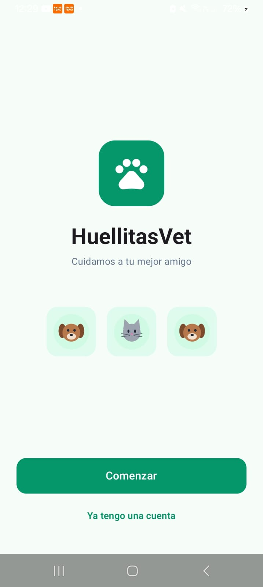 | 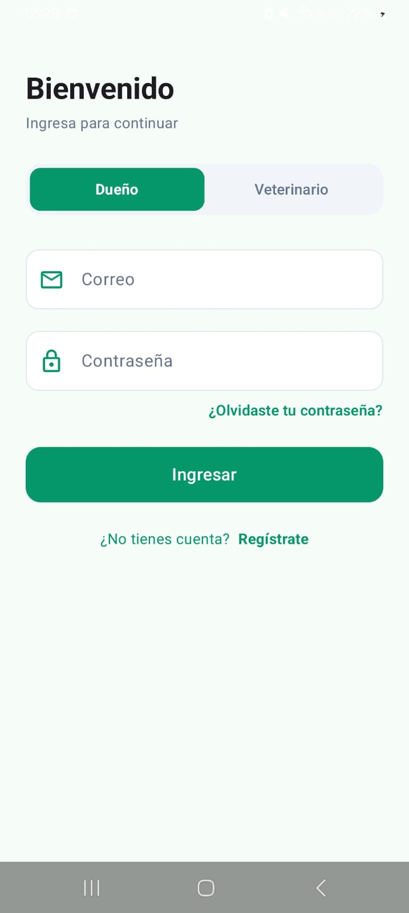 | 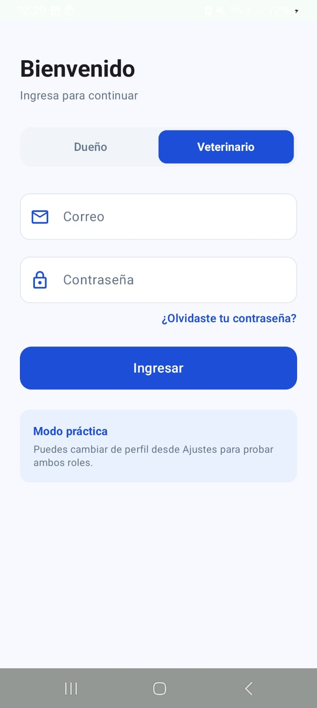 | 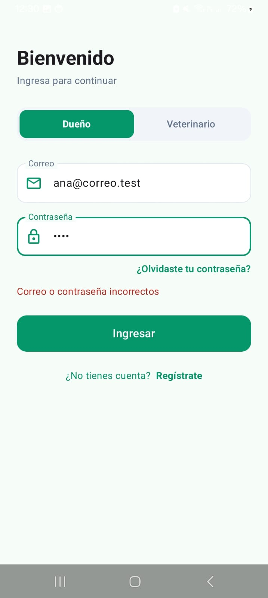 |

### Dueño

| Inicio | Mis mascotas | Ficha e historial |
|:---:|:---:|:---:|
| 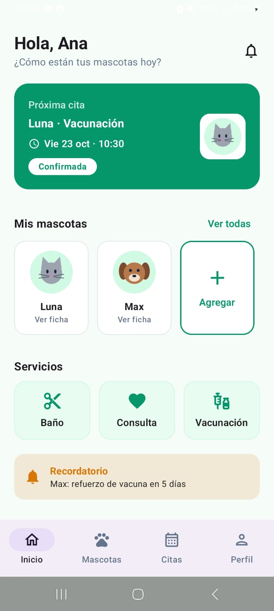 | 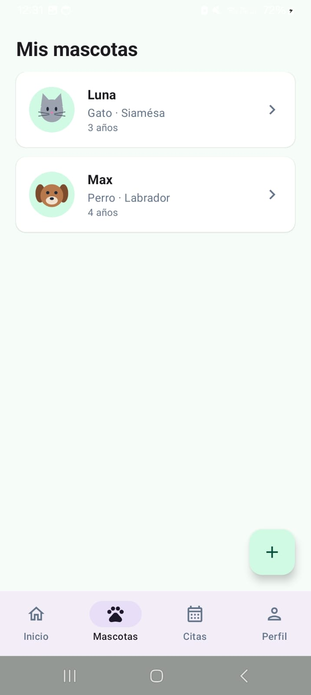 | 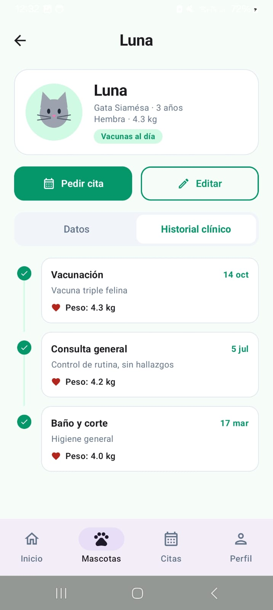 |

| Registrar mascota | Pedir cita | Pedir cita (horarios) |
|:---:|:---:|:---:|
| 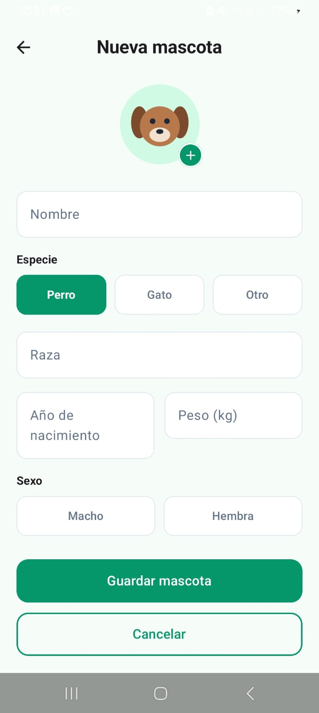 | 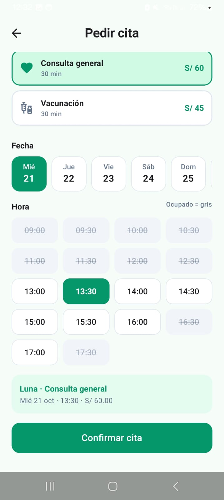 | 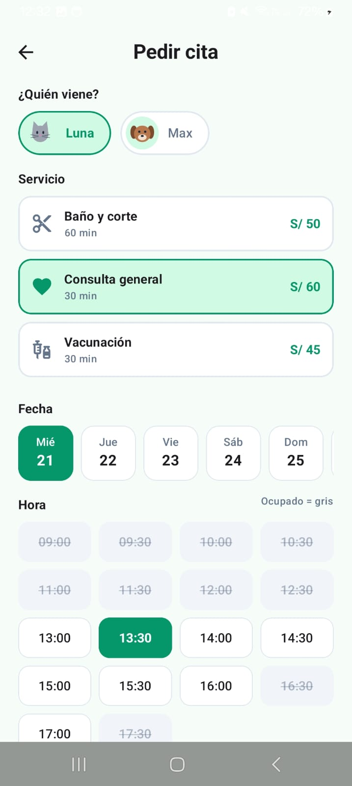 |

| Mis citas | No se puede cancelar a menos de 2 horas | Perfil |
|:---:|:---:|:---:|
| 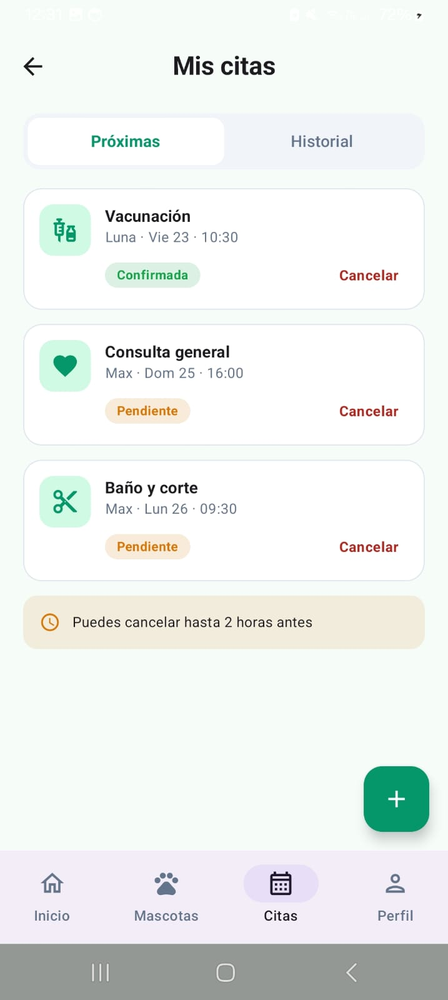 | 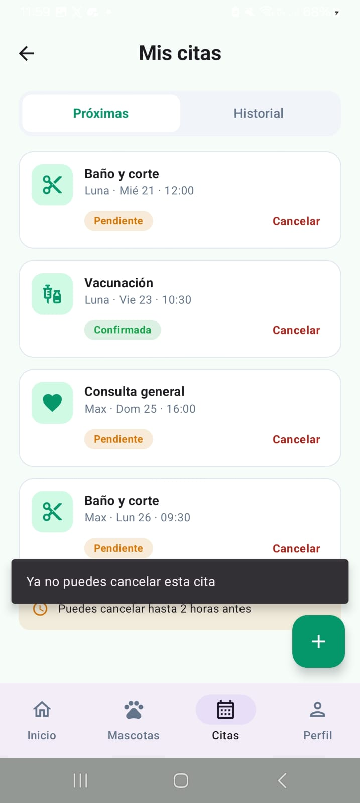 | 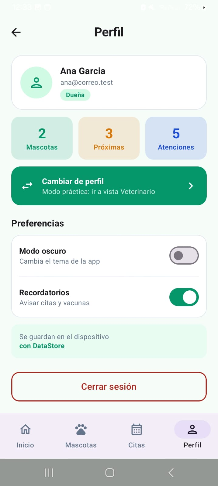 |

### Veterinario

| Panel | Panel (gráficos) | Agenda |
|:---:|:---:|:---:|
| 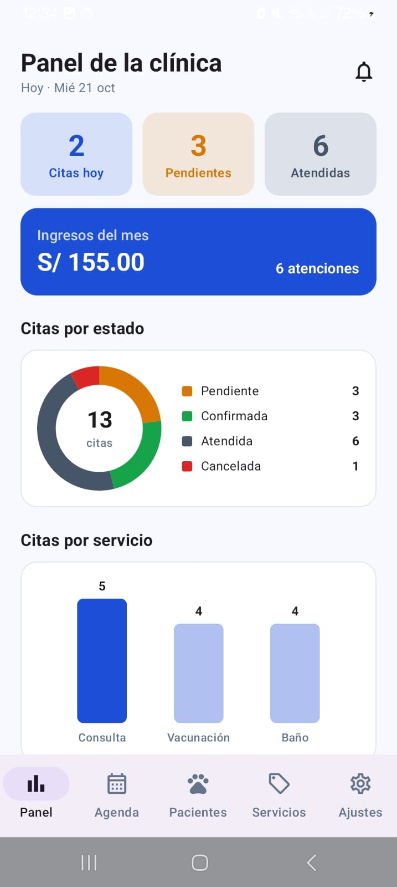 | 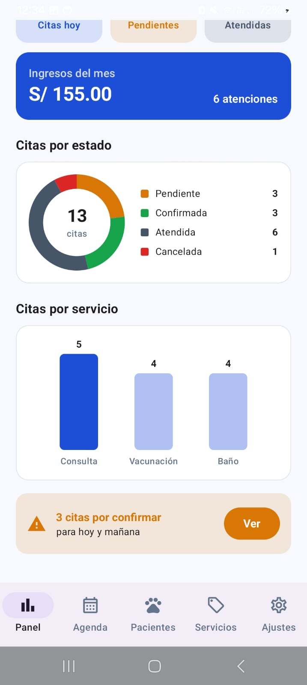 | 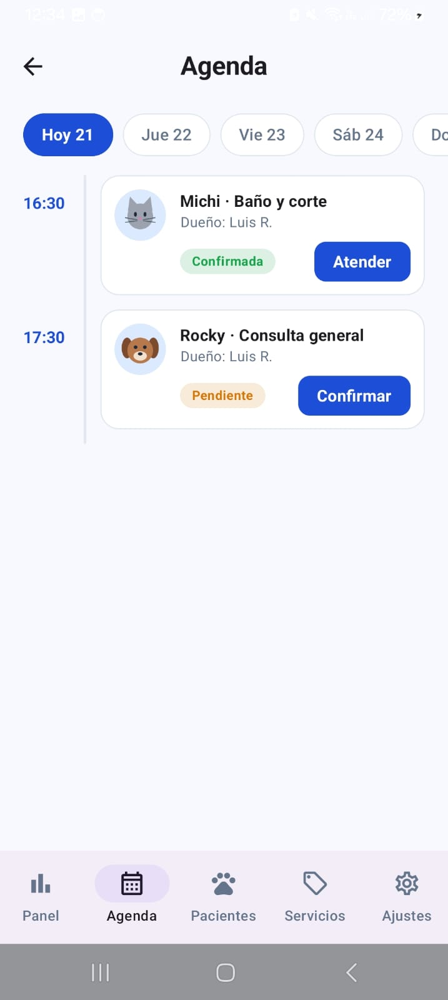 |

| Atender cita | Pacientes | Servicios |
|:---:|:---:|:---:|
| 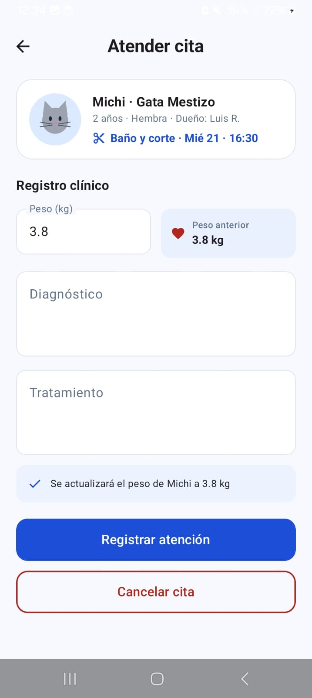 | 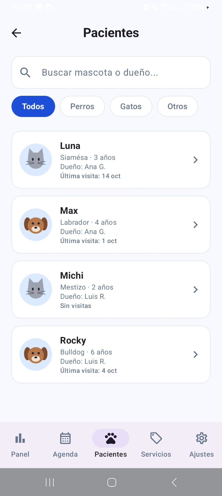 | 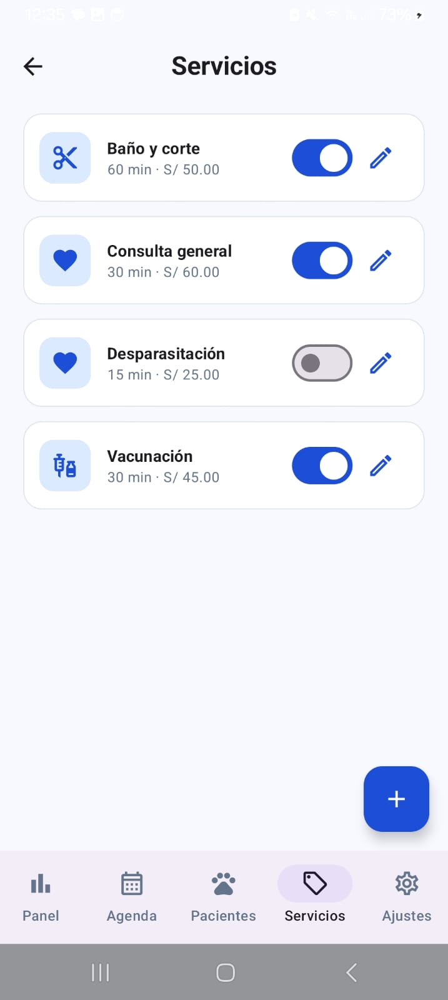 |

| Ajustes | Modo oscuro |
|:---:|:---:|
| 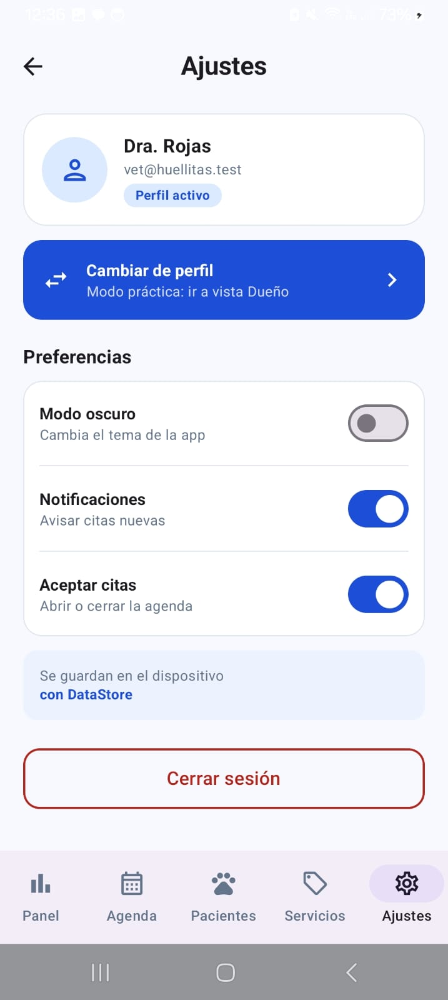 | 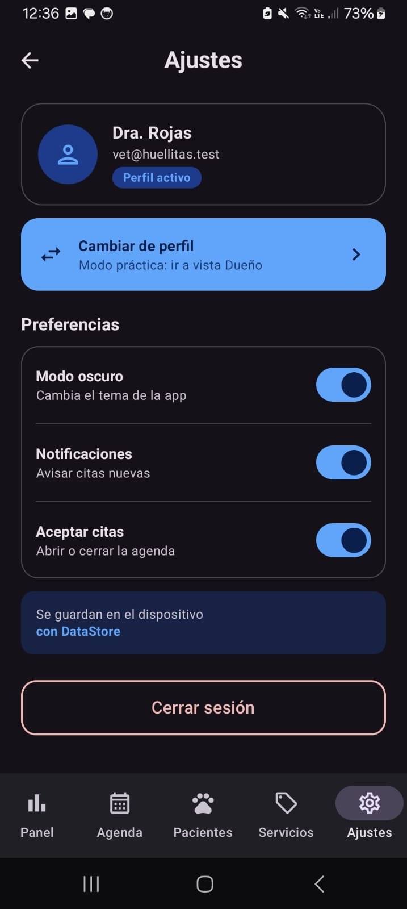 |

---

## 🧪 Pruebas de aceptación

| Prueba | Resultado esperado | OK |
|---|---|---|
| Login con clave incorrecta | Mensaje de error, no entra | ✅ |
| Dueño: registrar mascota sin nombre | Errores junto a cada campo, no se guarda | ✅ |
| Dueño: eliminar una mascota con citas | Mensaje de aviso y no se elimina | ✅ |
| Dueño: pedir cita | Aparece en Mis citas como PENDIENTE y con el precio del servicio | ✅ |
| Dueño: elegir un horario ocupado | El horario aparece gris y no se puede elegir | ✅ |
| Veterinario: agenda | La cita aparece en su hora y puede confirmarla; el dueño la ve CONFIRMADA | ✅ |
| Veterinario: atender una cita | Pasa a ATENDIDA, el dueño la ve en el historial y el peso se actualizó | ✅ |
| Dueño: cancelar una cita a menos de 2 horas | No se permite cancelar | ✅ |
| Veterinario: ingresos del mes | Coinciden con la suma del precio de las citas atendidas | ✅ |
| Veterinario: desactivar un servicio | Ya no se puede elegir al pedir una cita | ✅ |
| Veterinario: eliminar un servicio con citas | No se elimina; se muestra un mensaje | ✅ |
| Cerrar y abrir la app | Las citas siguen ahí y el perfil y el modo oscuro se recuerdan | ✅ |

---

## 💭 Para pensar

**1. ¿Por qué `VetRepository` es una interface y no una clase?**
Porque los ViewModels solo conocen el contrato, no cómo se guardan los datos. Hoy la implementación es `VetRepositoryRoom`, pero en la Semana 9 se podrá crear otra que use un servicio web y solo habrá que cambiar qué implementación crea `VetApp`. Ningún ViewModel ni pantalla tiene que cambiar.

**2. ¿Cuándo una función del DAO devuelve `Flow` y cuándo es `suspend`?**
Si la pantalla debe actualizarse sola cuando cambian los datos, es `Flow` (por ejemplo, `observarCitasPorFecha`). Si es una acción que se hace una sola vez, es `suspend` (por ejemplo, `insertar` o `registrarAtencion`). Gracias a `Flow`, cuando el veterinario confirma una cita, el dueño la ve cambiar sin recargar nada.

**3. ¿Por qué la fecha y la hora se guardan como texto?**
Porque el formato `aaaa-MM-dd` se ordena igual que las fechas, se compara directamente en SQL (`fecha >= :inicio`) y se convierte fácil con `LocalDate.parse()`. Así no hacen falta convertidores de tipos en Room.

**4. ¿Por qué se guarda el precio dentro de la cita si ya está en el servicio?**
Es una "foto" del precio en el momento de pedir la cita. Si la clínica sube el precio de un servicio, las citas antiguas conservan lo que costaron y los ingresos del panel no se alteran.

**5. ¿Por qué registrar una atención usa una transacción?**
Porque cambia dos tablas: la cita pasa a ATENDIDA y se actualiza el peso de la mascota. Con `db.withTransaction` se hacen las dos cosas o ninguna; si algo falla, no queda una cita atendida con el peso viejo.

**6. ¿Por qué las reglas de negocio están en el ViewModel y no en la pantalla ni en el DAO?**
La pantalla solo debe mostrar y avisar eventos, y el DAO solo debe leer y escribir. Si una regla cambia (por ejemplo, cancelar con 24 horas en lugar de 2), se modifica en un solo lugar: el ViewModel. Además, las reglas se pueden probar sin abrir ninguna pantalla.

**7. ¿Qué va en Room y qué va en DataStore?**
Room guarda los datos de la app con relaciones: usuarios, mascotas, citas y servicios. DataStore guarda preferencias pequeñas de tipo clave-valor: el perfil activo, el modo oscuro, las notificaciones y si la clínica acepta citas.

**8. ¿Cómo se evita que dos citas ocupen el mismo horario?**
La pantalla muestra en gris las horas ocupadas, que se observan con `flatMapLatest` según la fecha elegida. Además, antes de crear la cita, el ViewModel vuelve a consultar la base; si el horario se ocupó mientras tanto, muestra un mensaje y no crea la cita.

---

## 📝 Notas del desarrollo

- **Proyecto iniciado sin proyecto base.** Los archivos marcados como "entregados" en la guía (tema, componentes, `VetRepository`, `VetViewModelFactory`, enums, etc.) se crearon a partir de los contratos y mockups. Están en commits separados con el prefijo `chore:` para distinguirlos del trabajo de cada paso.
- **Funciones agregadas a la interface `VetRepository`**, declaradas primero en la interface y luego implementadas:
    - `obtenerUsuario(id)`: para recuperar al usuario cuando el Splash salta el login con una sesión guardada.
    - `obtenerUsuarioPorRol(rol)`: para "Cambiar de perfil" en el modo práctica.
- **Fechas relativas:** los datos iniciales usan `LocalDate.now().plusDays(n)`, como pide la guía, para que siempre haya citas de hoy, pasadas y futuras. Por eso las fechas cambian según el día de instalación.
- **"Vacunas al día" y "Recordatorio"** se calculan con datos reales: el refuerzo vence un año después de la última Vacunación ATENDIDA.
- **Elementos solo visuales del mockup:** "¿Olvidaste tu contraseña?" y "¿No tienes cuenta? Regístrate" no tienen función, porque el laboratorio trabaja con usuarios sembrados y la guía no incluye registro ni recuperación de contraseña.
