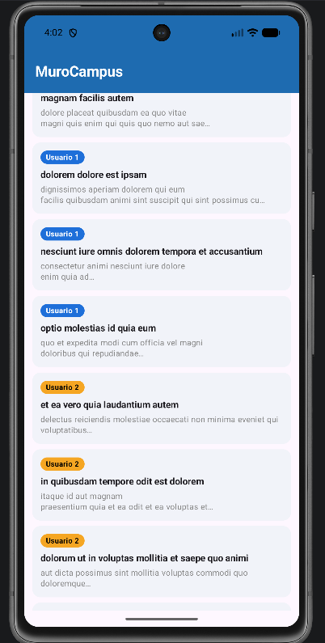
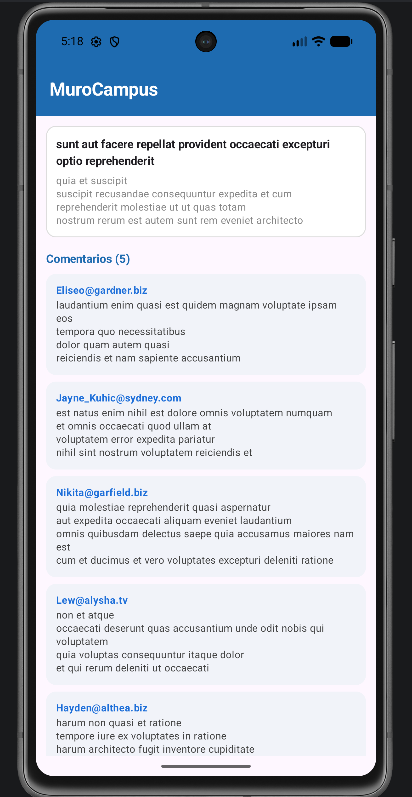
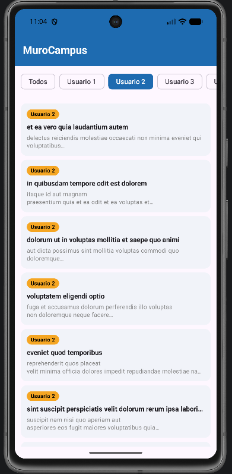
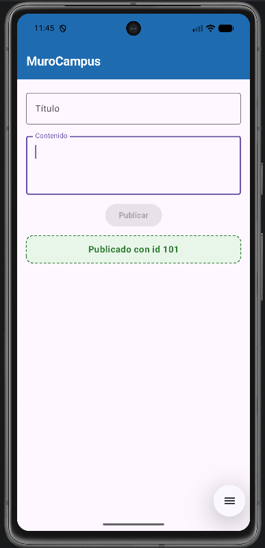
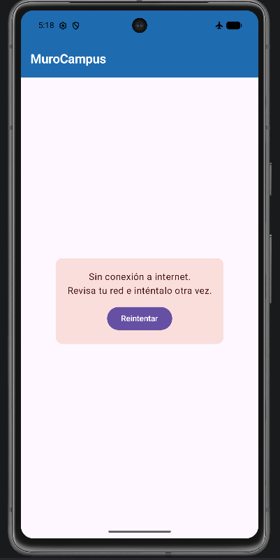

# MuroCampus

**Autor:** David 
**Curso:** Programación en Móviles · 4to ciclo · Semana 09: Servicios Web y plataforma REST

## Descripción
MuroCampus es una app Android en Jetpack Compose que consume el servicio REST de
[JSONPlaceholder](https://jsonplaceholder.typicode.com/). Permite:

- Listar las 100 publicaciones (`GET posts`).
- Ver el detalle de una publicación con sus comentarios (`GET posts/{id}` y `GET posts/{id}/comments`).
- Filtrar las publicaciones por usuario (`GET posts?userId=N`).
- Crear una publicación nueva (`POST posts` con JSON en el cuerpo).
- Mostrar los estados **Cargando**, **Éxito** y **Error** con botón **Reintentar**, también sin internet.

Tecnologías: Retrofit, OkHttp (con `HttpLoggingInterceptor`), kotlinx.serialization,
corrutinas, `StateFlow` y arquitectura MVVM + Repository.

## Estructura de paquetes
```
com.valcarcel.murocampus/
├── MainActivity.kt              Navegación (lista / detalle / crear), BackHandler y mensajeDe()
├── model/
│   └── Modelos.kt               Post, Comentario, NuevoPost
├── data/
│   ├── remote/
│   │   ├── PostApi.kt           Interface de Retrofit (@GET, @POST, @Path, @Query, @Body)
│   │   └── RetrofitClient.kt    Cliente único con OkHttp y conversor JSON
│   └── PostRepository.kt        Interface + PostRepositoryRemote (devuelve Result)
├── viewmodel/
│   ├── PostsViewModel.kt        UiState, DetalleUi y lógica de lista, detalle, filtro y crear
│   └── PostsViewModelFactory.kt Crea el ViewModel entregándole el Repository
└── ui/
    ├── Componentes.kt           TarjetaPost, Cargando, ErrorConReintento
    ├── PantallaLista.kt         Lista + chips de filtro
    ├── PantallaDetalle.kt       Publicación y comentarios
    ├── PantallaCrear.kt         Formulario para publicar
    └── theme/
```

> **Nota:** no se recibió el proyecto base. Los elementos marcados como [E] en la guía se
> implementaron así: `UiState` dentro de `PostsViewModel.kt`, los componentes visuales en
> `Componentes.kt`, la Factory en `PostsViewModelFactory.kt` y `mensajeDe()` en
> `MainActivity.kt`, para que la carpeta `viewmodel/` no conozca `HttpException`.

## Arquitectura MVVM + Repository
```
View (PantallaLista, PantallaDetalle, PantallaCrear)
  | eventos: cargar, filtrar, abrir, publicar     ^ collectAsStateWithLifecycle()
  v                                               |
ViewModel (PostsViewModel) --- StateFlow<UiState> (Cargando / Exito / Error)
  | viewModelScope.launch
  v
PostRepository (interface)        <- devuelve Result<...>
  -> PostRepositoryRemote         (captura IOException, HttpException...)
  |
  v
PostApi (Retrofit) --- OkHttp ---> https://jsonplaceholder.typicode.com/
```

Reglas respetadas:
- El ViewModel no conoce Retrofit, `PostApi`, `HttpException` ni `Context`.
- Ningún Composable llama a la API: las pantallas solo hablan con el ViewModel.
- El Repository nunca deja escapar una excepción: la convierte en `Result.failure`.

## Capturas

| Lista | Detalle | Filtro |
|---|---|---|
|  |  |  |

| Crear | Error de conexión |
|---|---|
|  |  |

## Pruebas de errores (Paso 10)

| Prueba | Resultado esperado | OK |
|---|---|---|
| Sin internet | Sin conexión a internet y botón Reintentar | ✅ |
| Reintentar | Carga la lista | ✅ |
| Recurso inexistente (`posts/9999`) | Error del servidor (404) | ✅ |
| JSON inesperado | Funciona con `ignoreUnknownKeys`; un campo que no llega da "Respuesta inesperada" | ✅ |
| Cancelación | Sin errores en Logcat | ✅ |
| Lista y detalle | Siempre 5 comentarios | ✅ |
| Filtro | Siempre 10 publicaciones | ✅ |
| Crear | Publicado con id 101 | ✅ |
| Código | `viewmodel/` sin Retrofit, PostApi ni HttpException | ✅ |

## Para pensar

**1. ¿Qué diferencia hay entre GET y POST? ¿Por qué crear lleva `@Body` y porUsuario lleva `@Query`?**
GET solo **lee** un recurso y no cambia nada en el servidor; POST **crea** un recurso nuevo.
`crear` lleva `@Body` porque tiene que enviar datos (el `NuevoPost` convertido a JSON) en el
cuerpo de la petición. `porUsuario` usa `@Query` porque no envía datos: solo **filtra** la
colección `posts` agregando `?userId=2` a la URL.

**2. ¿Por qué la ruta es `"posts"` y no `"/posts"`?**
Retrofit combina la ruta con la `baseUrl`. Si la ruta empieza con `/`, se toma como una ruta
absoluta desde la raíz del dominio y reemplaza el camino de la `baseUrl`. Sin la barra, la ruta
se agrega a continuación de la `baseUrl`, que termina en `/`.

**3. ¿Por qué el Repository devuelve `Result` en vez de dejar que la excepción llegue al ViewModel?**
Para que el ViewModel no tenga que conocer las excepciones de red (`IOException`,
`HttpException`) ni Retrofit. El ViewModel solo recibe éxito o fallo y lo convierte en un
`UiState`. Además, la app no se cierra por una excepción no capturada, y la fuente de datos se
puede cambiar (por ejemplo, a Room) sin tocar el ViewModel ni las pantallas.

**4. ¿Qué pasa si olvidas el permiso INTERNET? ¿Y si olvidas `ignoreUnknownKeys` y el servidor agrega un campo nuevo?**
Sin el permiso, la app compila pero toda llamada falla con un error de red
(`UnknownHostException` / `SecurityException`) aunque haya internet, y se muestra
"Sin conexión a internet". Sin `ignoreUnknownKeys`, cuando el JSON trae un campo que la
`data class` no tiene, kotlinx.serialization lanza `SerializationException` y la pantalla
muestra "Respuesta inesperada", aunque los datos que sí usamos estén bien.

**5. ¿Por qué la pantalla de lista usa un `when` sobre `UiState` y no un `if` con tres variables?**
Porque `UiState` es una `sealed interface`: solo puede estar en **un** estado a la vez, y el
compilador obliga a cubrir los tres casos en el `when`. Con tres variables separadas
(`cargando`, `error`, `datos`) se podrían dar combinaciones imposibles, como cargando y error
a la vez, y es fácil olvidar actualizar una.

**6. JSONPlaceholder no guarda los POST. ¿Cómo cambiaría tu app si usaras un servicio real?**
Al publicar con éxito, la publicación nueva sí existiría en el servidor. Habría que actualizar
la lista: recargarla con `cargar()` o agregar el post devuelto al inicio de la lista del
`StateFlow`. También habría que manejar la autenticación (por ejemplo, un token en un
encabezado) y validaciones del servidor (errores 400/401), mostrando su mensaje al usuario.